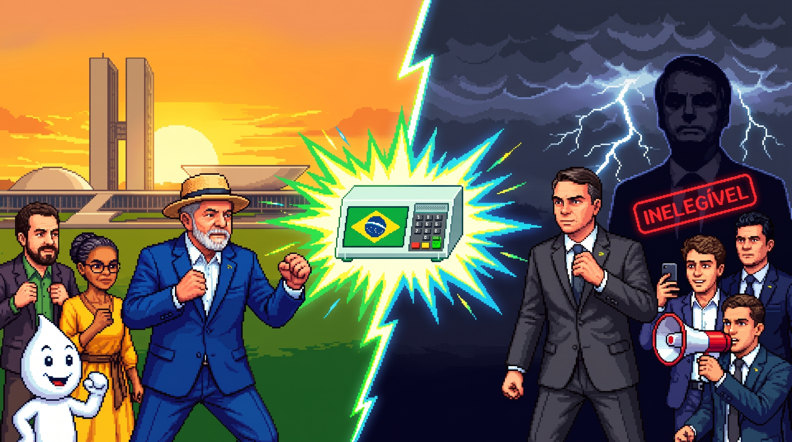

# DEMOCRACIA FIGHTER: A Batalha das Urnas (16-Bit Arcade)

<div align="center">



[](https://developer.mozilla.org/pt-BR/docs/Web/API/Canvas_API)
[](https://developer.mozilla.org/pt-BR/docs/Web/JavaScript)
[](https://developer.mozilla.org/pt-BR/docs/Web/API/Web_Audio_API)
[](https://github.com)
[](https://github.com)

*"O jogo onde o voto é soberano e o golpe é só no tatame!"*

[🕹️ Jogar Localmente](#-como-jogar-localmente) • [🎮 Controles](#-guia-de-comandos) • [🥊 Personagens](#-elenco-dos-defensores-da-democracia) • [🏛️ Pílulas de Cidadania](#-pílulas-de-cidadania--políticas-públicas) 

</div>

---

## Sobre o Jogo

**Democracia Fighter: A Batalha das Urnas** é um jogo de luta retrô no estilo arcade 16-bit (*Street Fighter Alpha / Capcom CPS2*), desenvolvido em **Vanilla JavaScript puro e HTML5 Canvas**, sem qualquer dependência ou framework pesado.

Ambientado na conjuntura política das Eleições 2026, o jogo une **sátira política inteligente, mecânicas de luta fluídas e conscientização democrática**, valorizando a história do Brasil, os serviços públicos (*SUS, Universidades, Meio Ambiente*) e a soberania das urnas eletrônicas.

---

##  Principais Recursos & Mecânicas de Fliperama

- **Super Freeze Dramático:** Congelamento de tela por 0.5s com escurecimento, rastro cintilante (*afterimages*) e banner retrô diagonal inspirado em *Marvel vs Capcom*.
- **K.O. Dramático com Câmera Lenta (*Slow-Motion 4x*):** No golpe decisivo, o tempo desacelera para 25% da velocidade, com onda de choque (*shockwave*), flash, aproximação dinâmica de câmera (*zoom in*) e letreiro tridimensional **K.O.!**.
- **Contador de Combos:** Encadeie golpes leves e pesados para gerar contadores dinâmicos (*2 HITS COMBO!*) com bônus real de dano.
- **Inteligência Artificial Dinâmica:** Oponentes pulam para desviar de projéteis, utilizam postura de defesa com dano reduzido (*chip damage*) e agacham para acelerar a carga de seus especiais.
- **Screen Shake & Wall Bounce:** Tremores de tela e impacto contra a borda do cenário ao desferir golpes pesados.
- **Cena Cinemática Final da Posse:** Ao vencer o chefe final, acompanhe a emocionante cutscene de celebração popular no Palácio do Planalto com a faixa presidencial e discurso de vitória.
- **Trilha Sonora & SFX 100% Sintetizados:** Áudios sintetizados em tempo real via **Web Audio API** (sem necessidade de arquivos de áudio pesados).
- **Compatibilidade Mobile Completa:**
  - **Auto-Fit 16:9:** Proporção de tela ajustada dinamicamente sem distorções nem cortes.
  - **Aviso de Rotação:** Detector que solicita virar o celular na horizontal para a melhor experiência.
  - **Multi-Touch Real:** D-pad e botões de ação simultâneos na tela com prevenção total de zoom acidental.
  - **Arena Limpa no Desktop:** Botões touch ocultos por padrão no computador, mantendo a arena 100% livre de poluição visual.

---

##  Guia de Comandos

###  Teclado (Computador)

| Ação | Tecla Principal | Tecla Alternativa |
| :--- | :---: | :---: |
| **Mover Esquerda / Direita** | <kbd>A</kbd> / <kbd>D</kbd> | <kbd>⬅️</kbd> / <kbd>➡️</kbd> |
| **Pular** | <kbd>W</kbd> | <kbd>⬆️</kbd> / <kbd>Espaço</kbd> |
| **Defender / Agachar (Carrega Especial)** | <kbd>S</kbd> | <kbd>⬇️</kbd> |
| **Soco Leve (Rápido)** | <kbd>J</kbd> | <kbd>Z</kbd> |
| **Chute Forte (Dano Alto)** | <kbd>K</kbd> | <kbd>X</kbd> |
| **Golpe Especial ⚡** *(Carrega Rápido)* | <kbd>L</kbd> | <kbd>C</kbd> |
| **Super Golpe 🔥** *(Gasta 100% da Barra)* | <kbd>U</kbd> | <kbd>E</kbd> |
| **Invocação de Apoio Popular 🤝** | <kbd>I</kbd> | <kbd>Q</kbd> |
| **Pausar / Retomar Luta** | <kbd>P</kbd> | <kbd>Esc</kbd> |
| **Alternar Tela Cheia** | <kbd>F11</kbd> | Botão <kbd>⛶</kbd> |

###  Celular & Dispositivos Touch

- **D-Pad Virtual:** Direcionais posicionados no canto inferior esquerdo para controle confortável com o polegar.
- **Botões Arcade:** Botões de toque responsivos no canto inferior direito (*Soco, Chute, Especial, Super e Apoio*).
- **Botão `TOUCH` no HUD:** Permite ligar ou desligar os botões virtuais a qualquer momento.

---

##  Elenco dos Defensores da Democracia

| Lutador | Papel / Arquétipo | Golpe Especial  | Super Golpe  |
| :--- | :--- | :--- | :--- |
| **Lula** | Reeleição 2026 / All-Around | *Onda Vermelha (Estrela 13)* | *A Voz da Massa: O 4º Mandato* |
| **Dilma Rousseff** | Brics Heavy / Zoner | *Estocadora de Vento Geopolítica* | *Reparação Histórica: Coração Valente* |
| **Marina Silva** | Autoridade Climática / Agile | *Fiscalização do IBAMA* | *Tsunami da Floresta Viva (COP30)* |
| **Érika Hilton** | Liderança do Plenário / Rushdown | *Giro do Leque Parlamentar* | *Baile da Democracia: Nocaute Ballroom* |
| **Guilherme Cortez** | Renovação Jovem / Fast Combo | *Megafone Universitário 2026* | *Rebelião da Juventude: Ocupa Brasília* |

---

##  Escada de Oponentes (Campanha 2026)

1. **NPC Bolsonarista** — *Cenário: Caravana da Anistia 2026 (Copacabana / Estrada)*
2. **Eduarda Campopiano** — *Cenário: Vão Livre do MASP (São Paulo)*
3. **Lucas Pavanato** — *Cenário: Avenida Paulista & MASP (São Paulo)*
4. **Sergio Moro** — *Cenário: Tribunal de Curitiba (Paraná)*
5. **Nikolas Ferreira** — *Cenário: Comício Viral 2026*
6. **Flávio Bolsonaro (Chefe Final)** — *Cenário: Congresso Nacional (Brasília 2026)*

###  Chefes Secretos da Urna
No menu principal, clique no botão **" CÓDIGO SECRETO / URNA"** e insira:
- `BOLSO`: Batalha secreta contra **Jair Bolsonaro (O Inelegível)** no condomínio de Orlando.
- `VORCARO`: Batalha secreta contra o banqueiro **Daniel Vorcaro** na Faria Lima.
- `CARLUXO`: Batalha secreta contra **Carlos Bolsonaro** na Fazenda de Bots & IA.
- `13` ou `FANDOM`: Habilita suporte contínuo dos Fandoms Pop & K-Pop durante a partida.

---

##  Pílulas de Cidadania & Políticas Públicas

Entre cada fase da campanha, o jogo apresenta cartões educativos com dados reais sobre conquistas da sociedade brasileira:

- **🏥 O SUS:** Maior sistema público e gratuito de saúde do mundo, atendendo mais de 190 milhões de brasileiros.
- **🎓 Universidades & Lei de Cotas:** Democratização histórica do acesso ao ensino superior público.
- **🍲 Segurança Alimentar & Bolsa Família:** Integração de renda e permanência escolar que retirou o país do Mapa da Fome da ONU.
- **🌳 Meio Ambiente & Terras Indígenas:** Demarcações e fiscalização como as ferramentas mais comprovadas pela ciência contra o desmatamento.
- **🌈 Direitos Civis & Diversidade:** Equiparação da homotransfobia ao crime de racismo e cidadania plena como cláusula pétrea.
- **💧 Infraestrutura Social:** Segurança hídrica da Transposição do São Francisco e moradia digna do Minha Casa Minha Vida.

---

##  Como Jogar Localmente

O projeto não exige Node.js, compilação nem instalação de pacotes:

1. Clone ou baixe este repositório:
   ```bash
   git clone https://github.com/SEU-USUARIO/jogo_democracia.git
   cd jogo_democracia
   ```
2. Abra o arquivo `index.html` diretamente em qualquer navegador moderno (**Chrome, Edge, Firefox ou Safari**).
3. Ou suba um servidor local rápido via Python:
   ```bash
   python3 -m http.server 8085
   ```
   E acesse `http://localhost:8085` no navegador.

---


##  Estrutura do Projeto

```text
jogo_democracia/
├── index.html            # Estrutura principal, HUD, telas e modais
├── css/
│   └── style.css         # Estilização arcade, design system, animações e responsividade
├── js/
│   ├── audio.js          # Síntese sonora em tempo real via Web Audio API (BGM e SFX)
│   ├── data.js           # Dados dos lutadores, chefes, fases e pílulas de cidadania
│   ├── sprites.js        # Renderização procedural de lutadores e partículas no Canvas
│   ├── stages.js         # Gerenciamento de cenários e parallax
│   └── game.js           # Engine de combate, IA, física, combos, câmera lenta e menus
├── assets/
│   ├── cenas/            # Imagens HD de cenários reais e telas finais
│   └── portraits/        # Retratos dos personagens do jogo
└── README.md             # Documentação oficial do projeto
```

---

## 📄 Licença

Este projeto é desenvolvido para fins educacionais, culturais e de entretenimento cívico sob a licença **MIT**. Sinta-se livre para jogar, compartilhar e contribuir com melhorias!

<div align="center">
  <b>© 2026 Frente Democrática Arcade • Pela Soberania Popular e o Estado Democrático de Direito</b>
</div>
